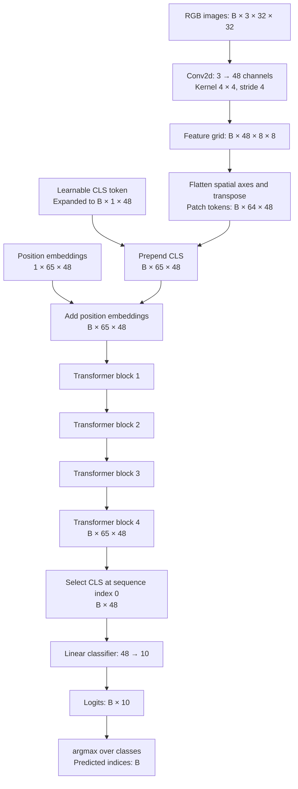
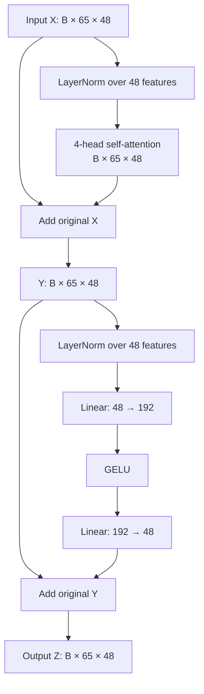
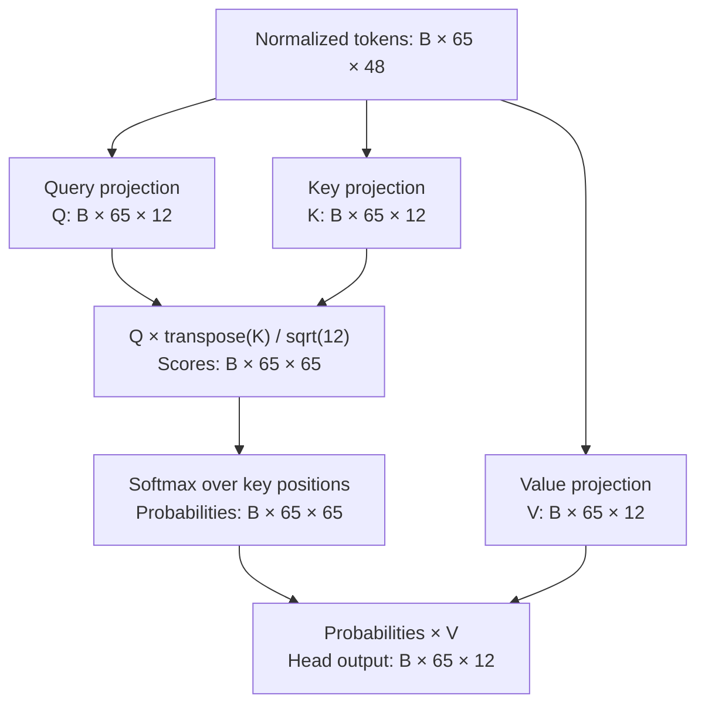

# Vision Transformer on CIFAR-10

A small Vision Transformer (ViT) implemented in PyTorch for classifying 32×32 RGB images into 10 classes. Includes explicit attention heads, CUDA mixed precision, early stopping, checkpoints, and TensorBoard logging.

## Setup and training

Run commands from the project root. Requires Python 3.12 or newer and `uv`.

```bash
uv sync --locked
uv run python src/train.py --exp-name first-run
```

The first run downloads CIFAR-10 into `data/`. The default run uses CUDA when available, otherwise CPU, with batches of 256 and up to 100 epochs. Early stopping ends training after 3 consecutive epochs without a new minimum evaluation loss.

Inspect arguments without downloading data or starting training:

```bash
uv run python src/train.py --help
```

### Example commands

A short CPU pipeline check; each epoch still processes the full dataset:

```bash
uv run python src/train.py \
  --exp-name cpu-check \
  --device cpu \
  --batch-size 32 \
  --epochs 2
```

A GPU experiment with periodic checkpoints and a longer patience:

```bash
uv run python src/train.py \
  --exp-name vit-cifar10-gpu \
  --device cuda \
  --batch-size 256 \
  --epochs 100 \
  --lr 0.001 \
  --patience 10 \
  --save-model-every 5
```

This example uses learning rate `0.001`; the code default is `0.01`. Neither setting guarantees convergence. Explicit CUDA selection requires a working CUDA environment. Use `--device cuda:0` to select a specific GPU.

To prevent early stopping within a fixed epoch budget, set patience equal to or greater than that budget:

```bash
uv run python src/train.py \
  --exp-name fixed-100-epochs \
  --epochs 100 \
  --patience 100
```

| Argument | Default | Meaning |
| --- | --- | --- |
| `--exp-name` | Required | Name used for checkpoint and logging directories. |
| `--batch-size` | `256` | Images per batch; the final batch can be smaller. |
| `--epochs` | `100` | Maximum training epochs. |
| `--lr` | `0.01` | AdamW learning rate; weight decay is fixed at `0.01`. |
| `--device` | Automatic | CUDA if available, otherwise CPU. |
| `--save-model-every` | `0` | Numbered checkpoint every N epochs; zero disables only numbered checkpoints. |
| `--patience` | `3` | Consecutive epochs without a strictly lower evaluation loss before stopping; must be at least 1. |

Use a unique experiment name per run. Reusing names can overwrite checkpoints and mix TensorBoard events. There is currently no resume command or learning rate scheduler.

## Evaluate the best checkpoint

After training `vit-run-01`, evaluate its best checkpoint on the CIFAR-10 test set:

```bash
uv run python src/main.py \
  --run experiments/vit-run-01/model_best.pt
```

The command loads `config.json` from the checkpoint's directory, selects CUDA if available (otherwise CPU), and evaluates only the first test batch. It prints a `(prediction, label)` class-name pair for each image in that batch followed by first-batch accuracy. The default evaluation batch size is 32; this accuracy does not represent the full test set. To choose the device and batch size explicitly:

```bash
uv run python src/main.py \
  --run experiments/vit-run-01/model_best.pt \
  --device cpu \
  --batch-size 256
```

Replace `vit-run-01` with your experiment name. Keep the experiment's `config.json` alongside its checkpoint; it must describe the architecture used to train those weights.

## Monitor with TensorBoard

Start this in another terminal from the project root:

```bash
uv run tensorboard --logdir runs
```

Open <http://localhost:6006>. Select experiment names to compare runs. The loop writes and flushes these metrics after each completed epoch:

| Tag | Meaning |
| --- | --- |
| `Loss/train` | Mean cross entropy per training image. |
| `Loss/test` | Mean cross entropy per test image. |
| `Accuracy/test` | Correct predictions divided by test images; a fraction between 0 and 1. |

The horizontal axis is epoch number, starting at 1. Logging is per epoch, not per batch. The writer closes when training finishes, stops early, or exits the logging context through an exception. The terminal also prints epoch metrics.

For a remote training host, run TensorBoard there and forward its port from your local machine:

```bash
ssh -L 6006:localhost:6006 user@training-host
```

Then open the same local URL. Training loss includes augmented inputs and weights changing during the epoch; test loss uses deterministic preprocessing and the weights at the end of the epoch. Their values measure different conditions.

## Data and preprocessing

CIFAR-10 has 50,000 training images and 10,000 test images. Each RGB image has shape `[3, 32, 32]` after conversion to a tensor.

| Index | Class |
| --- | --- |
| 0 | plane |
| 1 | car |
| 2 | bird |
| 3 | cat |
| 4 | deer |
| 5 | dog |
| 6 | frog |
| 7 | horse |
| 8 | ship |
| 9 | truck |

Training preprocessing applies, in order:

1. Convert to a tensor with values in `[0, 1]`.
2. Random horizontal flip with probability 0.5.
3. Random resized crop to 32×32, with area scale 0.8–1.0 and aspect ratio 0.75–approximately 1.333.
4. Normalize each channel with mean 0.5 and standard deviation 0.5, giving values approximately in `[-1, 1]`.

Test preprocessing only converts to a tensor and normalizes. Training data is shuffled; test data is not. Both loaders use two worker processes by default, configured in `src/data.py`.

**Evaluation split limitation:** the current loop uses CIFAR-10 test loss for early stopping and best checkpoint selection. For an unbiased final assessment, split the training data into training and validation subsets, use validation loss for these decisions, and reserve the test set for final evaluation. A separate validation split is not currently implemented.

## Model architecture

The `config` dictionary in `src/train.py` controls the architecture in `src/vit.py`. Below, `B` is the actual batch size, `N = 65` is the sequence length, and `D = 48` is the embedding width.

### Complete forward pass



Each transformer block has independent parameters and preserves the sequence length and feature width. The model returns both logits and attention matrices.

### 1. Patch embeddings

An image is divided into an 8×8 grid of nonoverlapping 4×4 patches:

```text
Patches per image = (32 / 4)² = 64
Input values per patch = 3 channels × 4 × 4 = 48
Output features per patch = 48
```

`Conv2d(3, 48, kernel_size=4, stride=4)` learns a projection from each patch into a 48-dimensional vector. The same projection weights are used at every patch location. The input patch size and embedding width both happen to be 48; the layer still learns a transformation rather than merely rearranging pixels.

The convolution gives `[B, 48, 8, 8]`. `flatten(2)` gives `[B, 48, 64]`, and `transpose(1, 2)` gives `[B, 64, 48]`: one token per patch, with 48 features per token.

### 2. CLS token and positions

The learnable classification token, or CLS token, has parameter shape `[1, 1, 48]`. Expanding it across the batch and prepending it gives 65 tokens:

```text
Sequence index:  0       1         2                    64
Token:         CLS    patch 0   patch 1     ...      patch 63
```

The initial CLS vector is shared across images. Attention makes its later representation depend on each image's patch content. Its final representation is used for classification.

Learnable position embeddings `[1, 65, 48]` are added element by element to distinguish patch locations and the CLS position. The position table is broadcast across the batch, so it is shared across images.

### 3. Transformer block and residual paths

Each block normalizes before attention and before the MLP:



The equations match `TransformerBlock.forward`:

```text
Y = X + MultiHeadAttention(LayerNorm₁(X))
Z = Y + MLP(LayerNorm₂(Y))
```

Residual paths preserve the unnormalized inputs around each sublayer. LayerNorm normalizes the 48 features of each token independently. Attention mixes information between tokens; the MLP transforms each token independently with shared weights.

### 4. Attention inside one head

There are four heads, each with feature width `48 / 4 = 12`. Every head has its own three learned projections from 48 to 12 features: query, key, and value.



For every image, each query token scores all 65 key tokens. Softmax operates along the last axis, so each query's weights sum to 1 across key positions. The weighted sum of value vectors produces the head output:

```text
Q, K, V = separate Linear(48, 12) projections of the input
P = softmax(Q Kᵀ / sqrt(12), dim=-1)
head_output = P V
```

This is full self-attention with no causal mask: every patch and the CLS token can attend to every token, including themselves. The batch dimension stays separate; attention does not mix different images.

The four outputs `[B, 65, 12]` are concatenated along the feature axis into `[B, 65, 48]`. A learned `Linear(48, 48)` output projection mixes these head features. `nn.ModuleList` registers the heads so their weights are optimized, moved with the model, initialized, and saved.

### 5. MLP and classifier

Each block's MLP expands the features fourfold, applies GELU, then projects back:

```text
[B, 65, 48] → Linear → [B, 65, 192] → GELU → Linear → [B, 65, 48]
```

After the fourth block, `x[:, 0, :]` selects the CLS vector for every image, giving `[B, 48]`. A `Linear(48, 10)` classifier produces raw class scores. The implementation feeds CLS directly into the classifier; there is no additional final encoder LayerNorm.

### 6. Return values, predictions, and loss

```python
logits, all_attn_probs = model(images)
predictions = logits.argmax(dim=1)
```

| Value | Shape or structure | Meaning |
| --- | --- | --- |
| `images` | `[B, 3, 32, 32]` | Normalized input images. |
| `labels` | `[B]` | Ground truth integer class indices, 0–9. |
| `logits` | `[B, 10]` | Ten raw scores per image. |
| `all_attn_probs` | 4 lists, each containing 4 tensors `[B, 65, 65]` | One probability matrix per block and head; this is not a single stacked tensor. |
| `predictions` | `[B]` | Highest scoring class index for each image. |
| `loss` | `[]` | Scalar tensor with mean cross entropy for the batch. |

`model(images)[0]` selects logits from the returned tuple, not the first image. The loop uses `logits, _ = model(images)` to unpack logits and ignore attention matrices.

`CrossEntropyLoss` takes raw logits directly; do not apply softmax or `argmax` before computing it. For probability inspection separately, use `logits.softmax(dim=1)`.

The batch loss is a mean, so epoch metrics weight batches by their actual sizes:

```text
epoch_loss = sum(batch_mean_loss × actual_batch_size) / total_images_processed
accuracy = total_correct_predictions / total_images_processed
```

This handles a smaller final batch correctly. `loss.backward()` computes gradients through the tensor; `loss.item()` extracts a Python number for metrics.

### Settings and initialization

| Setting | Value | Role |
| --- | --- | --- |
| `image_size` | `32` | Expected square image dimension. |
| `patch_size` | `4` | Patch height and width. |
| `num_channels` | `3` | RGB channels. |
| `hidden_size` | `48` | Token width. |
| `num_hidden_layers` | `4` | Encoder block count. |
| `num_attention_heads` | `4` | Heads per block. |
| `intermediate_size` | `192` | MLP hidden width. |
| `num_classes` | `10` | Classifier output width. |
| `qkv_bias` | `True` | Enables biases in query, key, value, and attention output projections. |
| `initializer_range` | `0.02` | Standard deviation for custom initialization. |

Linear and convolution weights use normal initialization with standard deviation 0.02 and zero biases. LayerNorm weights start at one and biases at zero. CLS and position embeddings use truncated normal initialization with the configured standard deviation.

Embedding width must be divisible by head count. Image dimensions should be divisible by patch size. The position table is fixed for the configured resolution; arbitrary input sizes are not supported.

Some configuration entries are placeholders: `hidden_dropout_prob` and `use_faster_attention` do not change execution. `attention_probs_dropout_prob` constructs a dropout module that is not applied in the forward pass. Default dropout probabilities are zero. Attention uses explicit per-head projections, matrix multiplication, and softmax.

## Training lifecycle and outputs

Each epoch trains on all training batches, then evaluates with `model.eval()` and `torch.no_grad()`. CUDA uses autocast for forward and loss computation, and `GradScaler` for backward and optimizer steps. AMP and scaling are disabled on CPU.

Early stopping tracks the lowest evaluation loss. A strictly lower loss resets its counter and saves the best checkpoint; an equal or higher loss increments the counter. When the counter reaches patience, the loop ends and completed metrics and final weights are saved.

```text
data/                               Downloaded CIFAR-10
runs/<exp-name>/                    TensorBoard event files
experiments/<exp-name>/
├── config.json                     Model configuration
├── metrics.json                    train_losses, test_losses, accuracies
├── model_best.pt                   Weights at lowest evaluation loss
├── model_final.pt                  Weights at last completed epoch
└── model_<epoch>.pt                Optional periodic checkpoints
```

The final model is not automatically restored to the best epoch. Load `model_best.pt` to use the selected weights. Checkpoints contain only the model state dictionary, without optimizer, scaler, or random generator state. `config.json` stores model configuration, not a complete record of training arguments. Metrics JSON and final weights are saved after normal completion or early stopping; they are not guaranteed after a crash or interruption.

To load weights in Python from the project root:

```python
import json
import sys
import torch

sys.path.insert(0, "src")
from vit import ViTForClassification

experiment = "experiments/first-run"
with open(f"{experiment}/config.json") as file:
    config = json.load(file)

model = ViTForClassification(config)
state = torch.load(f"{experiment}/model_best.pt",
                   map_location="cpu", weights_only=True)
model.load_state_dict(state)
model.eval()
# Feed image tensors normalized with the same evaluation preprocessing.
```

## Source layout

| File | Responsibility |
| --- | --- |
| `src/train.py` | Configuration, CLI, optimizer setup, training, evaluation, logging, and early stopping integration. |
| `src/vit.py` | Embeddings, attention, MLP, encoder, classifier, and initialization. |
| `src/data.py` | Download, preprocessing, data loaders, and class names. |
| `src/utils.py` | Checkpoints, experiment serialization, and early stopping state. |

Add dependencies with `uv add <package>` and commit `uv.lock` for reproducible installation.
